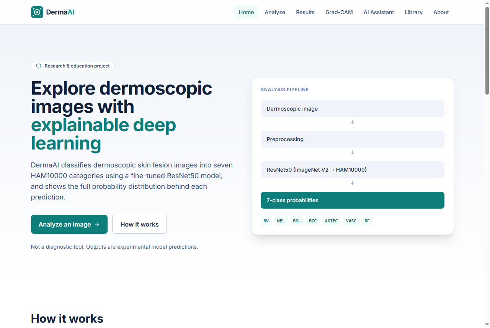
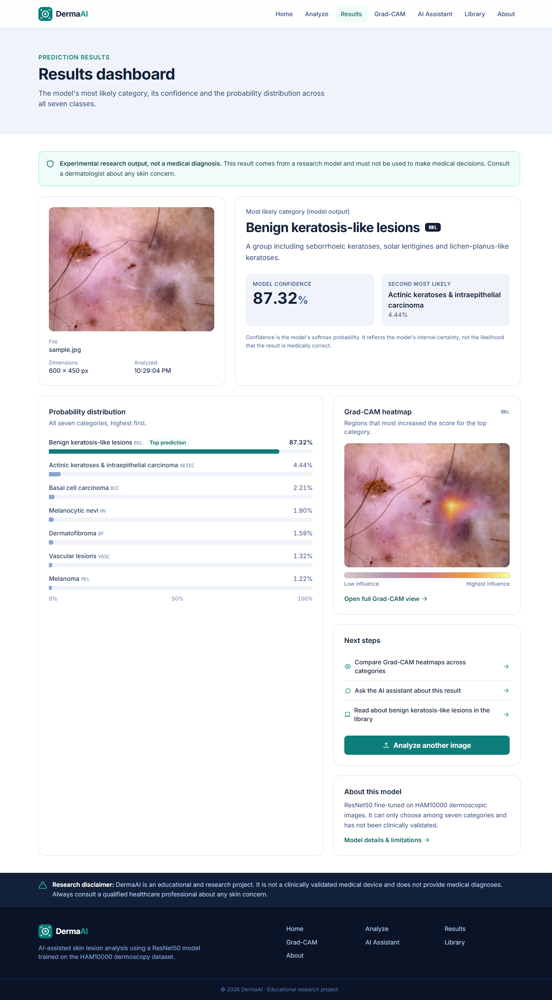
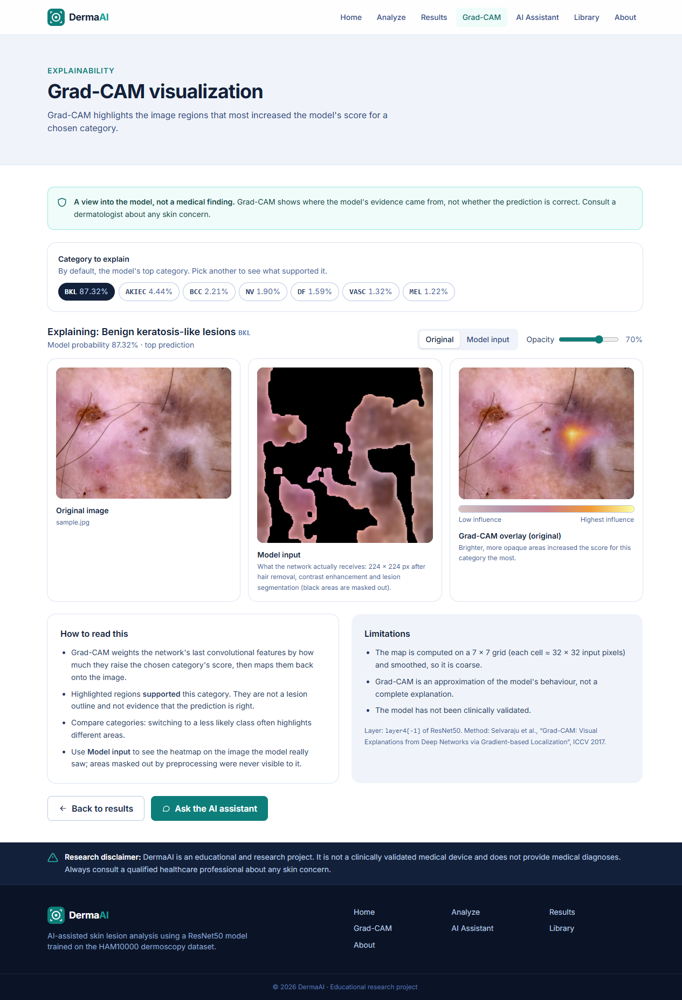
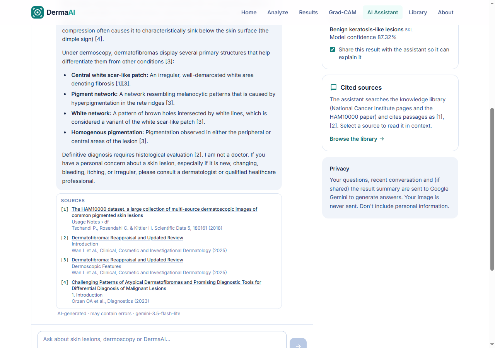
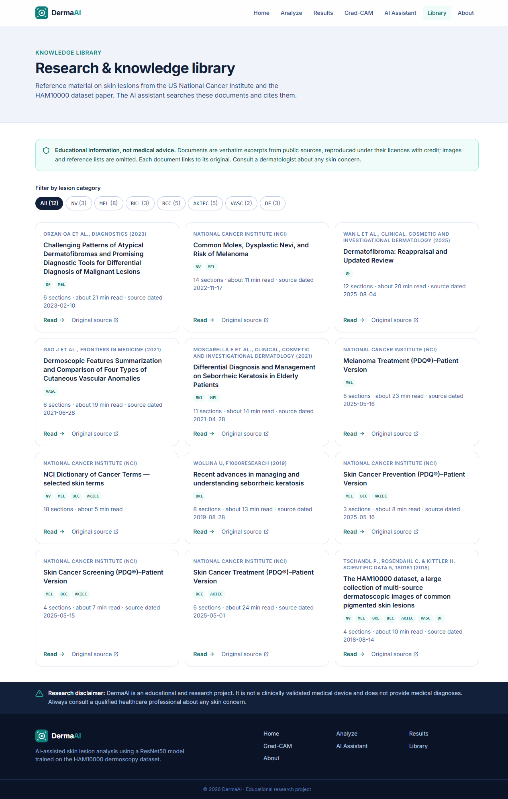
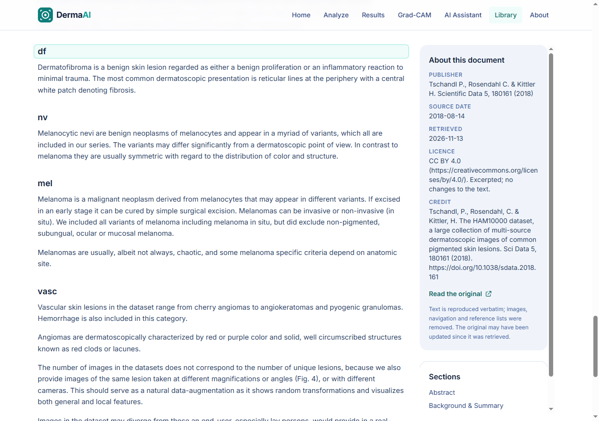

# DermaAI — AI-Assisted Skin Lesion Analysis

DermaAI is an educational research project. It classifies dermoscopic skin-lesion images into the
seven HAM10000 categories with a fine-tuned **ResNet50**. It explains each prediction with
**Grad-CAM** heatmaps and answers questions through a **Gemini-powered assistant**, which cites a
curated **knowledge library** (retrieval-augmented generation, RAG).

> **Not a medical device.** DermaAI has not been clinically validated. Its outputs are
> experimental model predictions, not diagnoses, and must not be used for medical decisions.
> Consult a dermatologist about any skin concern.

## Features

| Feature | What it does |
|---|---|
| **Seven-class prediction** | Shows the predicted category, the model's confidence and the probability of every class. |
| **Grad-CAM explainability** | Highlights the image regions that most increased the score of any chosen class. The heatmap can be shown on the original image or on the preprocessed image the model actually sees. |
| **AI assistant** | Answers educational questions (Gemini). It never diagnoses, can explain the user's latest result if the user chooses to share it, and cites its sources. |
| **Knowledge library** | 12 reference documents from the US National Cancer Institute, the HAM10000 paper and five open-access review/research articles. The assistant searches them by meaning (Gemini embeddings). |

## Screenshots

| Home | Results dashboard with Grad-CAM |
|---|---|
|  |  |
| **Grad-CAM view** | **AI assistant with cited sources** |
|  |  |
| **Knowledge library** | **Cited section in a library document** |
|  |  |

The seven categories are melanocytic nevi (`nv`), melanoma (`mel`), benign keratosis-like
lesions (`bkl`), basal cell carcinoma (`bcc`), actinic keratoses / intraepithelial carcinoma
(`akiec`), vascular lesions (`vasc`) and dermatofibroma (`df`).

## Architecture

```
React + Vite + Tailwind (frontend/)  ──/api──▶  FastAPI (backend/app/)
                                                  ├─ /api/predict  ─┐
                                                  ├─ /api/gradcam  ─┼─ ResNet50 + preprocessing (ml/)
                                                  ├─ /api/chat     ─── Gemini  ◀── retrieval (rag/)
                                                  └─ /api/library  ─── rag/documents/
```

- **Model:**
  - ResNet50 starting from ImageNet V2 weights, with a custom classifier head (Dropout → 512 → BN → 256 → 7).
  - Fine-tuned on HAM10000; the training notebook is in `extra/`.
  - Runs on CPU.
- **Preprocessing (identical in training and inference):** hair removal, CLAHE, Gaussian, median
  and bilateral filtering, Otsu lesion segmentation, edge enhancement, then normalisation.
- **Grad-CAM:** implemented directly in PyTorch on `layer4[-1]` (the same layer as the training notebook).
- **Assistant:**
  - Uses Google Gemini, with an automatic fallback model when the primary one is busy.
  - Follows educational-only safety rules.
  - Retrieval uses `gemini-embedding-001` and NumPy cosine similarity over about 330 passages.

## Getting started

### Requirements
- Python 3.10
- Node.js 20 or later
- The trained weights `best_resnet50.pth` (about 95 MB). They are **not stored in git**:
  download them from the **[v1.0 release](https://github.com/Abhivnaik/dermaai/releases/tag/v1.0)** and save the file as
  `ml/models/best_resnet50.pth`.
- A Gemini API key, for the assistant and library search only. Prediction and Grad-CAM work without one.

### Backend
```powershell
python -m venv .venv
.\.venv\Scripts\Activate.ps1          # macOS/Linux: source .venv/bin/activate
pip install torch==2.14.1 torchvision==0.29.2 --index-url https://download.pytorch.org/whl/cpu
pip install -r requirements.txt
copy .env.example .env                # then add your GEMINI_API_KEY
python -m uvicorn backend.app.main:app --host 127.0.0.1 --port 8000
```
Startup takes up to a minute while PyTorch and the model load. Wait for
`Application startup complete`. API docs: <http://127.0.0.1:8000/docs>

### Frontend
```powershell
cd frontend
npm install                           # in PowerShell use npm.cmd if scripts are blocked
npm run dev
```
Open <http://127.0.0.1:5173>. The dev server forwards `/api` to the backend.

### Knowledge library (optional)
The documents and the search index are included. To rebuild them:
```powershell
python -m rag.fetch_sources           # re-download the sources (licences are checked automatically)
python -m rag.ingest                  # rebuild the search index (needs GEMINI_API_KEY)
```
See [rag/README.md](rag/README.md) for the sources, their licences and how to add documents.

## API

| Method | Endpoint | Purpose |
|---|---|---|
| POST | `/api/predict` | Image (`file`) → predicted class, confidence, all probabilities |
| POST | `/api/gradcam` | Image (`file`) and optional `target_class` → probabilities and Grad-CAM PNG images |
| POST | `/api/chat` | `{question, history?, prediction?}` → answer and cited `sources` |
| GET | `/api/library` | Library documents and search-index status |
| GET | `/api/library/{id}` | One document's metadata and Markdown text |
| GET | `/health` | Health check |

Uploads must be JPG, PNG or WEBP and at most 10 MB. Images are processed in memory and never stored.

## Tests
```powershell
pip install -r requirements-dev.txt
python -m pytest
```
There are 20 API tests covering:
- prediction on `tests/sample.jpg` (expected: `bkl`, 87.32%);
- Grad-CAM;
- the library;
- chat routing and validation;
- rejection of bad uploads.

The chat tests replace Gemini with stand-ins, so they need no API key.

## Model performance

The training notebook (`extra/skin-training-resnet50 (2).ipynb`) reports these results on its
held-out test split: 1,503 images, a stratified 70/15/15 split with `random_state=42`.

| Metric | Value |
|---|---|
| Accuracy | 86.63% |
| Balanced accuracy (mean recall over the 7 classes) | 82.2% |
| Melanoma recall / precision | 70.1% / 63.6% |

**Caveat:** the split was made per *image*, not per *lesion*. HAM10000 contains several images of
many lesions, so some test images probably show lesions that also appear in training. These
figures are therefore likely optimistic. They have not been independently re-evaluated, and
they say nothing about clinical performance.

## Limitations
- Not clinically validated, and not suitable for diagnosis.
- Trained only on dermoscopic images. Ordinary phone photos are outside its training distribution.
- It always chooses one of seven classes, even for images of something else.
- HAM10000 is imbalanced: about 67% of images are `nv`.
- The training preprocessing's lesion segmentation can mask out large parts of an image. Use
  the Grad-CAM page's *Model input* view to see this.
- Grad-CAM is a coarse (7×7) approximation of what drives a prediction, not a lesion outline.

## Project structure
```
backend/app/        FastAPI app: routes (predict, gradcam, chat, library) and services
ml/                 Model loader, preprocessing, Grad-CAM, trained weights (not in git)
rag/                Knowledge-library documents, fetcher, indexer and retriever
frontend/           React + Vite + Tailwind web app
tests/              API tests and sample image
extra/              Original training notebook (Kaggle, Tesla T4)
```

## Data and licences
- **HAM10000:** Tschandl P., Rosendahl C. & Kittler H. *Sci Data* 5, 180161 (2018),
  <https://doi.org/10.1038/sdata.2018.161>. Licensed for non-commercial use.
- **Knowledge-library documents:** each records its source, licence and credit line. The licences are
  US Government works (NCI), CC BY and CC BY-NC. See [rag/README.md](rag/README.md).
- **Grad-CAM method:** Selvaraju R.R. et al., "Grad-CAM: Visual Explanations from Deep
  Networks via Gradient-based Localization", ICCV 2017.

DermaAI is an educational, non-commercial project.
